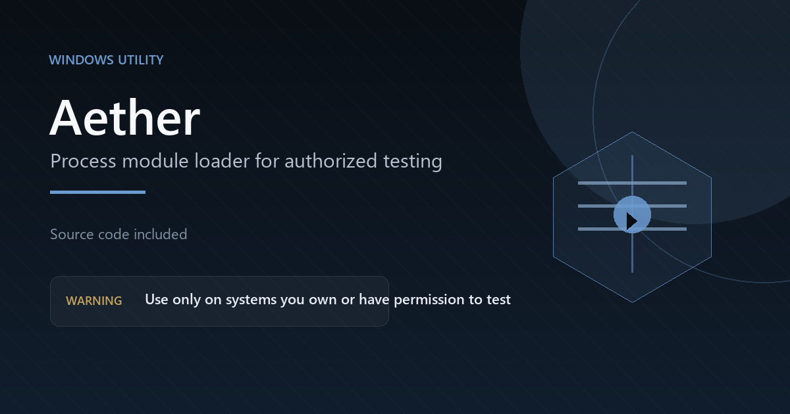

# Aether

Small Windows GUI for loading a DLL into a process with Windows APIs.



## What it does

* Lists running processes
* Lets you search by process name or PID
* Shows the target process architecture
* Lets you pick a DLL
* Loads the DLL and reports if it worked
* Runs elevated because opening another process usually needs admin access

## Warning

Use this only on software you own or have permission to test. Do not use it on other people's processes or software you do not control.

This kind of tool can be blocked by antivirus and may not be allowed by some hosting services. Check the rules before you upload or share it.

## Run it

1. Install Python 3.10 or newer for Windows.
2. Open a terminal in this folder.
3. Install the package:

```bat
pip install -r requirements.txt
```

4. Run:

```bat
Aether.bat
```

You can also run `python main.py`. Windows will ask for admin access.

## Files

* `main.py` starts the app
* `ui.py` is the desktop interface
* `loader.py` contains the process and loading logic
* `elevate.py` handles the admin check
* `verify_load.py` is a small local test script
* `requirements.txt` has the Python package

## Notes

The app uses standard Windows process APIs. It does not include a DLL and it does not download anything. Bring your own DLL and only use it on a target you control.

This folder did not include a license file. If you did not write it yourself, check with the original author before publishing it.
